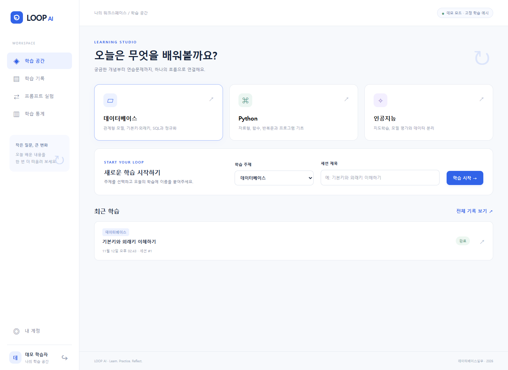

# LOOP AI · 전공 학습 이력 관리

FastAPI + PostgreSQL 17 + HTML/CSS/JavaScript로 구현한 데이터베이스실무 기말 프로젝트입니다. **주제 선택 → 학습 세션 → AI 대화 → 문제 풀이 → 기록·통계 조회**와 **프롬프트 A/B 실험**을 실제 DB에 저장합니다.



## 빠른 실행 (Windows PowerShell)

준비물: Python 3.12 이상, Git, 실행 중인 Docker Desktop(Linux containers). 아래 명령은 저장소 루트에서 실행합니다. 프런트엔드용 Node.js 설치는 필요 없습니다.

```powershell
git clone https://github.com/seeun-jang/LOOP-AI-DB.git
cd LOOP-AI-DB
# 이 구현이 아직 main에 병합되지 않았다면:
git switch feat/runnable-final-project
python -m venv .venv
.venv/Scripts/python.exe -m pip install -r requirements.txt
.venv/Scripts/python.exe scripts/setup_env.py
docker compose up -d --wait
.venv/Scripts/python.exe -m uvicorn backend.main:create_app --factory --host 127.0.0.1 --port 8000
```

브라우저에서 **http://127.0.0.1:8000** 을 엽니다. API 명세·실행 도구는 **http://127.0.0.1:8000/docs** 입니다. 새로 가입하거나 공개 시연 계정 `demo_student` / `LoopDemo2026!`로 로그인합니다. 이 계정은 연습용이며 개인 정보를 넣지 마세요. 회원가입 없이 실행되는 정적 HTML이 아니라, 서버에서 제공하는 화면을 사용해야 합니다.

macOS/Linux에서는 가상환경 실행 경로만 `.venv/bin/python`으로 바꾸면 됩니다. 서버 종료는 Ctrl+C, DB 정지는 `docker compose stop`, 재시작은 `docker compose up -d --wait`입니다. 데이터는 Docker 볼륨에 보존됩니다.

## AI 실행 모드

- **기본 `AI_PROVIDER=demo`**: 키·인터넷 없이 실행합니다. 주제별 고정 개념 설명·단답형 문제를 제공하며, 공백·대소문자를 정규화한 정답 일치 채점을 합니다. 화면과 저장된 응답에 데모임을 표시합니다. 자유 대화·생성형 A/B 효과를 검증하는 모드는 아닙니다.
- **`AI_PROVIDER=gemini`**: `.env`에 `GEMINI_API_KEY`와 계정에서 사용 가능한 `GEMINI_MODEL` ID를 설정하고 서버를 재시작합니다. 개념 대화, JSON 형식 문제 생성, 의미 기반 채점, A/B 생성을 Gemini REST API로 실행합니다. 모델 ID를 코드에 고정하지 않았습니다. 실제 키를 사용한 라이브 호출은 이번 검증에 포함하지 않았습니다.

Gemini 오류·시간 초과·응답 형식 오류는 502로 알리고 요청 전체를 롤백합니다. 데모 응답으로 몰래 전환하지 않습니다. A/B 모두 성공해야 실험 1개와 결과 2개가 저장됩니다. 대화 문맥은 최근 메시지 12개와 새 질문으로 제한하며 원본 기록은 보존합니다. Gemini 모드에서는 입력과 대화 문맥이 Google API에 전송됩니다.

## 환경 설정

`scripts/setup_env.py`가 고유한 DB 암호와 48바이트 난수 서명 키를 생성하여 `.env`에만 저장합니다. 기존 `.env`는 덮어쓰지 않습니다. `.env.example`은 설정 항목의 예시이며 그대로 실행하지 않습니다.

| 항목 | 용도 |
|---|---|
| `POSTGRES_DB`, `POSTGRES_USER`, `POSTGRES_PASSWORD` | Docker DB 초기화 계정 |
| `POSTGRES_PORT` | 기본 5433, 127.0.0.1에만 노출 |
| `DATABASE_URL` | Python 서버 접속 URL. 포트·계정 변경 시 함께 변경 |
| `JWT_SECRET` | 32자 이상의 임의 서명 키 |
| `ACCESS_TOKEN_MINUTES` | 기본 60분 |
| `AI_PROVIDER` | `demo` / `gemini` |
| `GEMINI_API_KEY`, `GEMINI_MODEL` | Gemini 모드에서 필수 |
| `AI_TIMEOUT_SECONDS` | 외부 응답 제한, 기본 30초 |

기존 PostgreSQL을 사용하려면 빈 DB를 만들고 `.env`의 `DATABASE_URL`을 설정한 뒤 아래 순서로 실행합니다. 서버는 테이블을 자동 생성하거나 기존 스키마를 파괴하지 않습니다.

```powershell
psql -v ON_ERROR_STOP=1 -d loop_ai -f database/schema.sql
psql -v ON_ERROR_STOP=1 -d loop_ai -f database/seed.sql
psql -v ON_ERROR_STOP=1 -d loop_ai -f database/queries.sql
```

`schema.sql`은 **새 DB에 1회** 실행합니다. `seed.sql`은 반복해도 기존 비밀번호·기록을 덮어쓰지 않으며 시퀀스를 뒤로 이동시키지 않습니다. `queries.sql`은 8개 테이블의 조회·생성·수정·삭제 실습을 수행하고 마지막에 ROLLBACK하므로 원본 기록을 변경하지 않습니다. 번호 시퀀스의 공백은 정상입니다.

Docker를 사용할 때는 다음과 같이 SQL 시연을 실행할 수 있습니다.

```powershell
docker compose cp database/queries.sql db:/tmp/loop-queries.sql
docker compose exec db sh -c 'psql -U "$POSTGRES_USER" -d "$POSTGRES_DB" -v ON_ERROR_STOP=1 -f /tmp/loop-queries.sql'
```

## 5분 시연 순서

1. 시연 계정 로그인 또는 회원가입 → 데이터베이스 주제와 세션 제목 입력 → 학습 시작.
2. ‘기본키와 외래키의 차이를 설명해줘’ 질문 → 사용자·AI 메시지가 함께 저장됨을 확인.
3. 연습문제 생성 → ‘외래키’ 제출 후 ‘기본키’ 재제출 → 두 풀이와 피드백이 모두 남음 확인.
4. 제목·상태 수정에서 제목 변경, 상태를 완료로 변경 → 학습 기록에서 다시 열기. 새로고침 후에도 대화와 풀이가 유지됨 확인.
5. 학습 통계에서 세션 수·제출 수·정답률 확인. 초기 시연 데이터는 DB 주제 1회, 2회 제출, 정답률 50%.
6. 프롬프트 실험에서 공통 질문과 A/B 지시 입력 → 두 응답과 실험 이력 확인.
7. 새 회원으로 로그인 → 다른 회원의 기록이 보이지 않음을 확인. 삭제는 별도 연습 세션으로 시연.

캡처와 화면별 설명은 [스토리보드](docs/storyboard.md), [화면 이미지](docs/screenshots), [요구사항 대응표](docs/requirements.md)를 참고하세요. 캡처는 실제 실행한 데모 모드 화면입니다. 이미지에 표시된 임시 시연 세션·실험은 검증 후 정리되었습니다.

## 설계 및 저장 구조

```text
backend/       FastAPI, 인증, 입력 검증, 서버 전용 AI 연결
database/      schema.sql / seed.sql / queries.sql
frontend/      index.html / style.css / favicon.svg / app.js
docs/          요구사항, 테이블 명세, 관계도, API, 스토리보드, 검증 결과
scripts/       안전한 환경 설정 생성
tests/         실제 PostgreSQL 통합 검증
compose.yaml   PostgreSQL 실행·최초 초기화
.env.example   커밋 가능한 환경 설정 샘플
```

정확히 8개 테이블·8개 PK·7개 FK입니다. [관계형 스키마](docs/relational_schema.md), [테이블 명세서](docs/table_spec.md), [설계 조정 내역](docs/implementation_notes.md)에 SQL과 문서의 대응을 기록했습니다. 테이블은 `users`, `topics`, `sessions`, `messages`, `questions`, `attempts`, `prompt_experiments`, `experiment_results`입니다.

공용 학습주제는 SQL로 관리하며 일반 회원의 주제 변경 API는 제공하지 않습니다. 메시지·문제·풀이는 학습 흐름에서 생성하고 기록을 보존합니다. 세션 제목·상태와 회원 정보는 UI에서 수정하며, 세션·실험·회원 삭제 시 관련 데이터를 CASCADE합니다. 8개 테이블 각각의 SQL CRUD는 `queries.sql`에 있습니다.

## 검증 실행

```powershell
.venv/Scripts/python.exe -m pip install -r requirements-dev.txt
.venv/Scripts/python.exe -m pytest -q --tb=short
```

검증한 의존성 전체 버전을 재현하려면 `requirements-dev.lock.txt`를 설치할 수 있습니다(Python 3.12 기준).

PostgreSQL이 실행 중이어야 합니다. 테스트는 임의의 `loop_test_*` 스키마를 생성하고 그 안에서만 데이터를 다룬 뒤 제거합니다. 앱 DB 계정에 테스트용 CREATE SCHEMA 권한이 필요합니다. `public`의 실제 학습 기록은 건드리지 않습니다. 통합 검증, 브라우저 검증 범위와 제한은 [검증 결과](docs/validation.md)에 기록했습니다.

## 보안과 운영 범위

- Argon2id 비밀번호 해시, HS256 서명 토큰(만료·발급자·대상 검증), 로그인 회원을 기준으로 한 모든 하위 기록의 소유권 검사를 적용했습니다. 다른 회원의 ID를 직접 요청해도 404입니다.
- 회원의 비밀번호 변경·탈퇴 후 기존 토큰은 무효화됩니다. 일반 로그아웃은 해당 탭의 토큰을 지웁니다. 서버에 토큰 폐기 목록을 두지 않으므로 복사된 토큰은 비밀번호 변경 또는 만료 전까지 유효합니다.
- 토큰은 `sessionStorage`, SQL은 매개변수 바인딩을 사용합니다. 화면의 사용자·AI 텍스트는 `textContent`로 표시하고 CSP를 적용합니다. 비밀번호와 AI 키는 응답·입력 오류 메시지에 노출하지 않습니다.
- 서버는 `frontend/`만 정적으로 제공합니다. `.env`, SQL, Git 기록은 웹으로 제공하지 않습니다. 실제 `.env`와 가상환경·로그는 커밋하지 않습니다.
- 로그인·가입은 IP당 분당 20회로 제한합니다(단일 서버 프로세스 기준). AI 요금 한도·분산 요청 제한·배포용 TLS/프록시는 별도 운영 구성입니다.
- Docker의 최초 초기화 계정은 로컬 실습 편의를 위한 DB 소유자입니다. 공개 운영 시 최소 권한 DB 계정, HTTPS, 비밀 관리, 시연 계정 제거, 백업을 별도로 구성해야 합니다. 기본 설정은 로컬 시연을 대상으로 합니다.

## 실행 문제 해결

- `docker ... engine` 연결 오류: Docker Desktop을 먼저 시작하고 Linux containers 모드인지 확인합니다.
- 5433 포트 사용 중: `.env`의 `POSTGRES_PORT`와 `DATABASE_URL` 포트를 함께 바꿉니다.
- DB 인증 실패: 기존 볼륨의 암호는 `.env`를 바꿔도 자동 변경되지 않습니다. 최초 생성 시 사용한 암호와 일치시키거나 DB에서 직접 변경하세요. 데이터 볼륨을 삭제해 해결하지 마세요.
- 테이블 없음: 기존 볼륨에는 초기화 SQL이 재실행되지 않습니다. 빈 DB에 `schema.sql`·`seed.sql`을 순서대로 적용합니다. 사용 중인 DB의 구조 변경은 먼저 백업하고 별도 마이그레이션으로 처리하세요.
- AI 502: Gemini 키·모델 권한·요금 및 할당량을 확인합니다. 오프라인 시연은 `.env`의 `AI_PROVIDER=demo`로 변경한 뒤 서버를 재시작합니다.

## 확인한 공식 문서

[FastAPI 데이터베이스 의존성](https://fastapi.tiangolo.com/tutorial/sql-databases/) · [Gemini generateContent REST API](https://ai.google.dev/api/generate-content)
