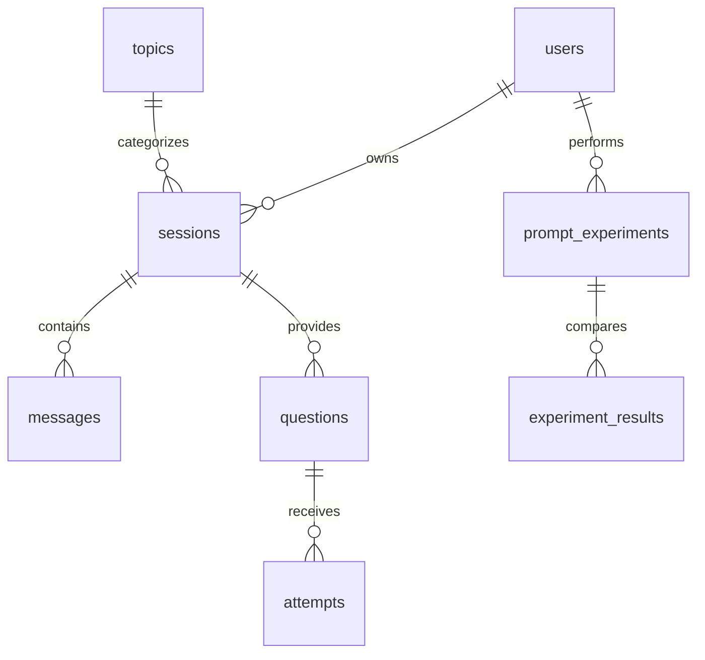

# 확정 관계형 스키마

`database/schema.sql`이 실행 기준이며, 아래 구조와 `er_diagram.drawio`를 같은 8개 테이블·7개 관계로 맞췄다. 기존 루트 PNG와 설계 보고서는 원본 참고 자료로 보존했다.

| 테이블 | PK | FK | 주요 일반 속성 |
|---|---|---|---|
| users | user_id | — | password_hash, name, email |
| topics | topic_id | — | name, description |
| sessions | session_id | user_id → users, topic_id → topics | title, started_at, status |
| messages | message_id | session_id → sessions | role, content, created_at |
| questions | question_id | session_id → sessions | content, answer, explanation |
| attempts | attempt_id | question_id → questions | submitted_answer, is_correct, submitted_at, ai_feedback |
| prompt_experiments | experiment_id | user_id → users | question, created_at |
| experiment_results | result_id | experiment_id → prompt_experiments | variant, prompt, response |

- 회원과 주제는 각각 세션에 연결한다. 회원↔주제의 직접 FK는 없다.
- 풀이의 소유자는 question → session → user, 실험결과의 소유자는 experiment → user로 구한다. 소유자 열을 중복 저장하지 않는다.
- 회원 삭제 시 소속 세션·실험, 세션 삭제 시 메시지·문제·풀이, 실험 삭제 시 결과를 CASCADE한다. 사용 중인 주제 삭제는 RESTRICT한다.
- DB는 한 실험의 A/B 최대 2개를 보장한다. 애플리케이션은 성공한 실험에 A/B 각 1개가 모두 존재하도록 한 트랜잭션으로 저장한다. 직접 SQL로 불완전한 실험을 넣을 수 있으므로 SQL 관리 작업은 이 규칙을 따라야 한다.
- 학습 횟수는 주제별 세션 수, 정답률은 TRUE 풀이 수 / 전체 풀이 수다. NULL(채점 대기)은 분모에 포함하며 별도 pending_count도 반환한다. 제출 0회는 NULL이며 화면에 ‘풀이 없음’으로 표시한다.
