# LOOP AI 전체 화면 스토리보드

화면은 2026-11-12에 실제 FastAPI·PostgreSQL 앱을 실행해 캡처했다. 데스크톱 1440×1050, 모바일 390×844 기준이다. 캡처는 고정 학습 예시를 제공하는 **데모 모드**이며 Gemini 라이브 호출 결과가 아니다. 사용자 입력과 응답·풀이·실험은 실제 DB에 저장하고 새로고침 후 다시 조회했다.

## 전체 사용자 흐름

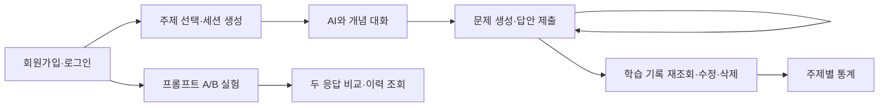

| 화면 | 사용자 동작 | 처리·저장 | 연결 요구사항 |
|---|---|---|---|
| SB-01 로그인 | 아이디·비밀번호 입력 또는 공개 시연 계정 선택 | Argon2id 검증 후 만료 있는 토큰 발급 | 01, 02, 15 |
| SB-02 회원가입 | 아이디·비밀번호·이름·이메일 입력 | 필수값·중복 검사, users INSERT | 01, 02 |
| SB-03 학습 시작 | 주제 카드 선택, 제목 입력, 학습 시작 | topics SELECT, 로그인 회원의 sessions INSERT | 03~06 |
| SB-04 AI 대화 | 개념 질문 입력, 보내기 | messages에 사용자·AI 응답을 한 트랜잭션으로 INSERT | 07, 08 |
| SB-05 문제·반복 풀이 | 문제 생성, 오답 후 정답 재제출 | questions INSERT, 매 제출마다 attempts INSERT·피드백 보존 | 08~11 |
| SB-06 학습 기록 | 이전 세션 열기, 제목·상태 변경, 기록 삭제 | 소유 세션과 하위 기록 SELECT, sessions UPDATE/DELETE | 12, 15, 16 |
| SB-07 학습 통계 | 주제별 횟수·제출·정답률 확인 | DISTINCT 세션 수와 전체 제출 기준 집계, 저장 테이블 추가 없음 | 12 |
| SB-08 A/B 실험 | 공통 질문·두 지시 입력, 비교 실행 | prompt_experiments 1행, experiment_results 2행 원자적 저장 | 13, 14, 16 |
| SB-09 내 계정 | 정보 변경·비밀번호 변경·탈퇴 | users UPDATE/DELETE, 비밀번호 변경으로 기존 토큰 무효화 | 01, 02, 15 |
| SB-10 모바일 | 작은 화면에서 주제·메뉴 탐색 | 같은 API·DB 사용, 반응형 배치 | 전반 UI |

## 실제 구현 화면

### SB-01 · 로그인
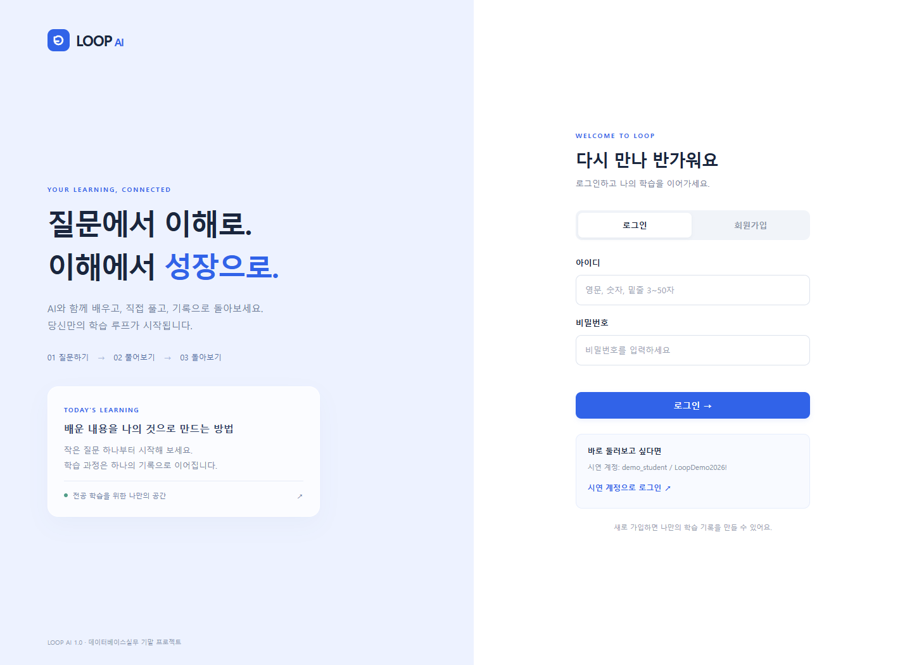
**입력:** 아이디·비밀번호. **결과:** 인증 후 학습 공간으로 이동. 인증 실패 시 같은 화면에 오류 표시. 시연 계정은 공개된 예제 계정이다.

### SB-02 · 회원가입
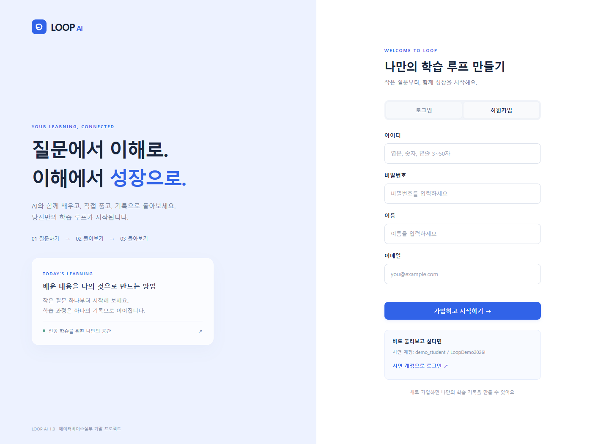
**입력:** 회원아이디 3~50자, 비밀번호 10~128자, 이름, 이메일. **결과:** 비밀번호 해시를 저장하고 바로 학습 공간으로 이동. 중복 아이디는 409로 거절.

### SB-03 · 주제 선택과 학습 시작
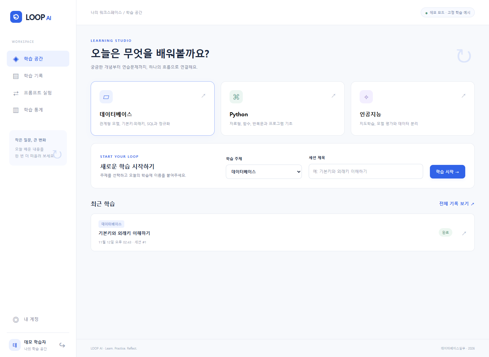
**입력:** 데이터베이스/Python/인공지능 중 주제와 세션 제목. **결과:** 소유자·주제·시작일시·진행중 상태를 가진 새 세션 생성. 최근 기록에서 이어갈 수 있다.

### SB-04 · AI 대화
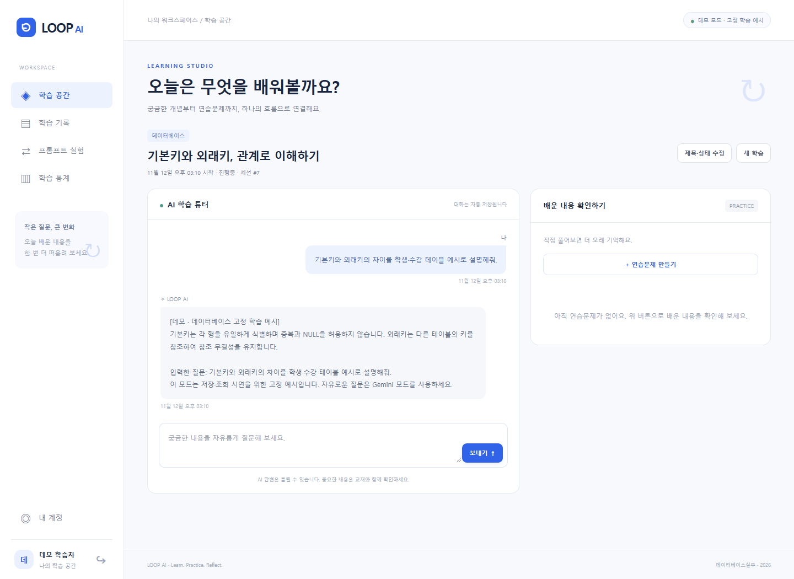
**입력:** 기본키·외래키 개념 질문. **결과:** 사용자·AI 주체와 작성시각을 구분해 표시하고 저장. 외부 호출 실패 시 두 메시지 모두 저장하지 않는다.

### SB-05 · 문제 생성과 반복 풀이
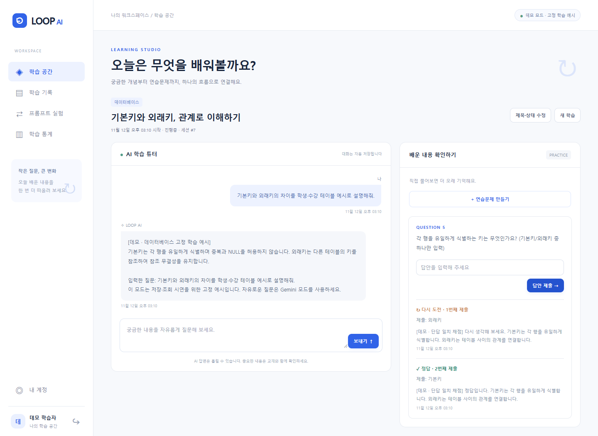
**입력:** ‘외래키’ 오답 후 ‘기본키’로 재제출. **결과:** 두 시도와 피드백이 각각 남는다. 과거 답안을 덮어쓰지 않는다. 데모 채점은 단답 일치 기준이다.

### SB-06 · 학습 기록 관리
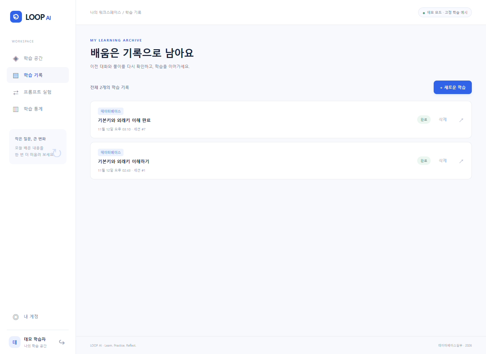
**동작:** 완료로 바꾼 세션을 다시 열고 새로고침. **결과:** 저장된 대화와 두 풀이가 복원된다. 삭제는 확인 후 메시지·문제·풀이까지 함께 제거한다.

### SB-07 · 학습 통계
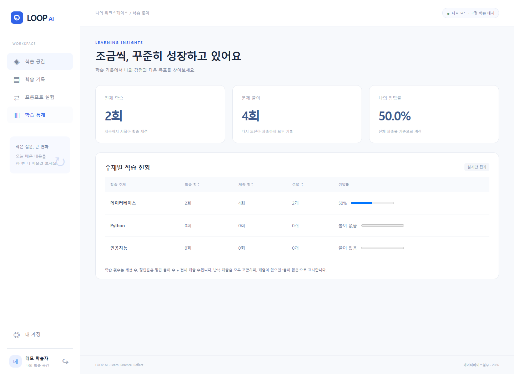
**결과:** 주제별 세션 수·제출 수·정답 수·정답률. **기준:** 정답 수÷전체 제출 수. 반복 제출을 포함하고 세션 중복 집계를 방지한다. 풀이 0건은 ‘풀이 없음’.

### SB-08 · 프롬프트 A/B 비교
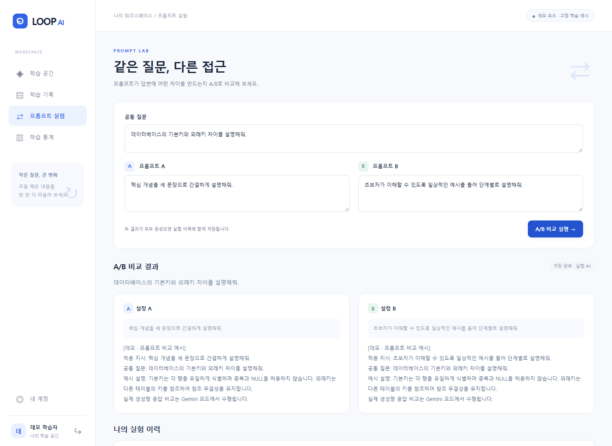
**입력:** 같은 질문, 간결한 설명 A와 예시 중심 B 지시. **결과:** 실제 사용한 지시와 두 응답을 함께 저장·비교한다. 이 화면은 데모라 지시·저장 흐름만 검증하며 생성형 차이 분석은 Gemini 모드에서 수행한다.

### SB-09 · 내 계정
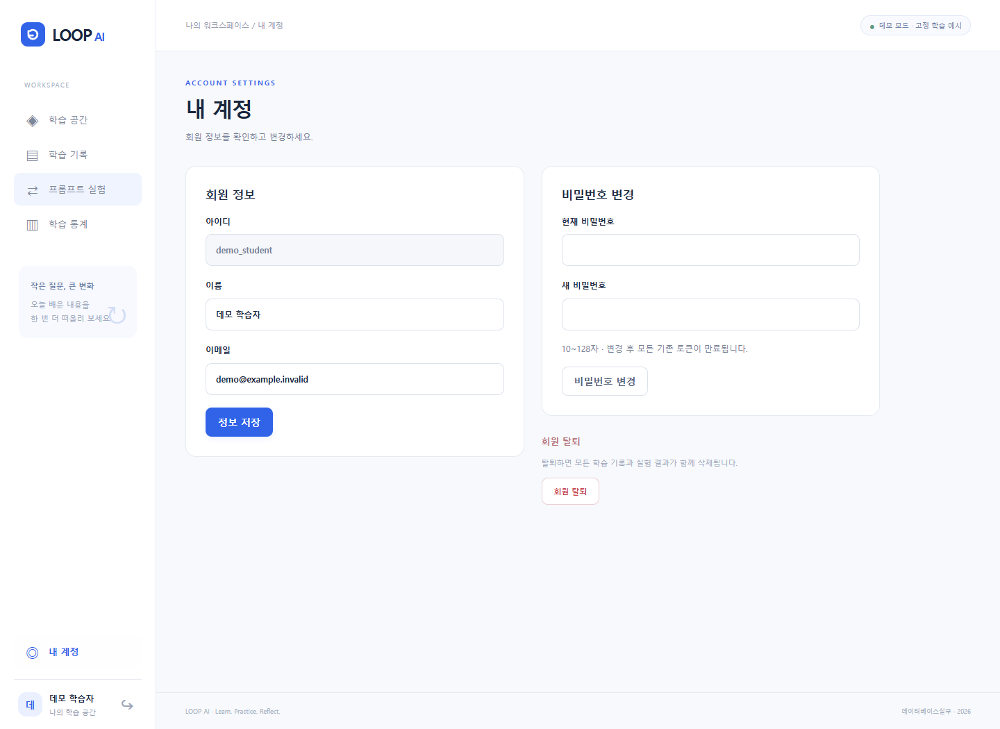
**동작:** 이름·이메일 수정, 현재 비밀번호 확인 후 비밀번호 변경, 비밀번호 재확인 후 회원 탈퇴. **결과:** 내 데이터만 변경하며 탈퇴 시 소속 학습·실험도 제거.

### SB-10 · 모바일 학습 공간
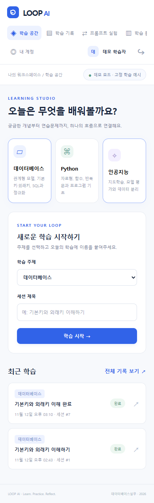
**결과:** 390px 화면에서 메뉴·카드·입력창이 재배치되고 문서 전체의 가로 넘침이 없다. 모바일과 데스크톱은 같은 저장 데이터를 사용한다.

## 보고서 삽입

- [화면 스토리보드 PDF](reports/LOOP_AI_storyboard.pdf): 전체 흐름, 화면별 설명, 실제 캡처, 검증·제한 포함.
- [기존 보고서 + 구현 부록 통합 PDF](reports/LOOP_AI_final_report.pdf): 원본 설계 보고서 11쪽을 유지하고 구현 부록을 덧붙인 파일.
- 편집 가능한 이 Markdown과 원본 PNG를 함께 제공한다. 학교 보고서 서식에는 필요한 화면을 선택해 그림 번호·설명을 붙여 넣으면 된다.
